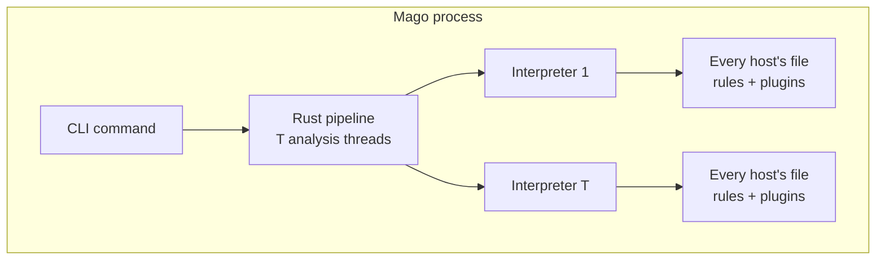
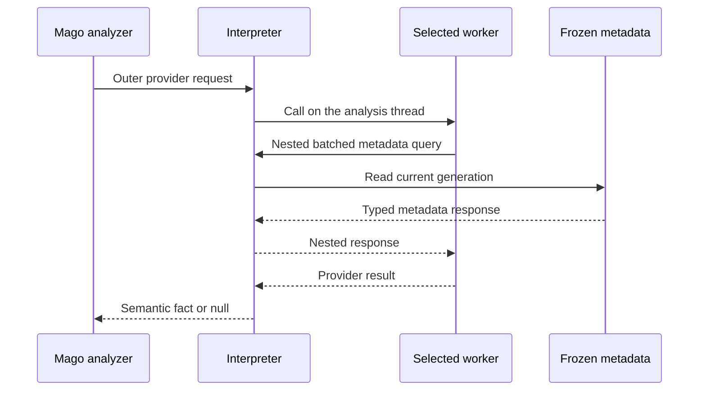

+++
title = "Architecture and execution model"
description = "How Mago runs extension workers, exchanges data, and orders extension callbacks."
nav_order = 40
nav_section = "Extensions"
+++
# Architecture and execution model

Mago keeps parsing, target matching, scheduling, and analysis in Rust. Extension workers run in PHP inside Mago, on the PHP# engine linked into the `mago` binary, receive compact, capability-specific views and return explicit results. This preserves Mago's parallel pipeline while allowing framework knowledge to live in PHP extensions.

## Hosts, workers, and logical extensions

The three terms have distinct meanings:

- A **host** is one `[extension-hosts.NAME]` configuration entry and its file.
- A **worker** is what a host's file registers. Each analysis thread's interpreter runs its own copy of every host's worker.
- An **extension** is one logical bundle of rules and plugins a worker advertises. The PHP SDK represents it as `Mago\Sdk\Extension`.

One worker may host multiple extensions. Every interpreter runs the same files, so every copy of a worker constructs equivalent extensions, rules, plugins, targets, and capabilities.

## Registration

Each command starts the enabled hosts it needs. The linter registration exchange describes extension identity, linter rule definitions, and worker-reduction support. `mago analyze` performs a separate analyzer registration exchange for extension identity, plugin definitions, targets, data requirements, and worker-reduction support.

Mago rejects conflicting or inconsistent registration before the corresponding lint or semantic-analysis work is dispatched. A worker started again after it fails replays the successful bootstrap exchanges before serving ordinary requests.

Use `mago extension validate` to validate host startup and linter registration without linting files. Analyzer registration and plugin selection are exercised by `mago analyze`.

## Transport

Mago calls each worker in its analysis thread's interpreter and passes each request and response as a binary message, with error responses for what a worker throws. A worker asks Mago codebase queries during a request through the same call, which Mago answers on the same thread.

Mago loads its own copy of the PHP SDK into each interpreter before any host's file, so the SDK classes a worker uses are always the ones the running `mago` ships, whatever version the project's `vendor` folder holds.

## Scheduling and parallelism

Each analysis thread sends its requests to the worker in its own interpreter, so the workers run in parallel as the analysis does, and no request waits for another thread's.

Each interpreter serves one request at a time. A request that waits on a nested codebase query keeps its turn: Mago answers the query on the same thread, and the request goes on.
## Data minimization

Mago does not send every source file or its complete syntax tree by default.

- Linter rules declare `NodeKind` targets. Mago sends only files with active targets and only the syntax subtrees needed by those rules.
- Codebase-scan hooks declare path targets. Only matching host files are included.
- Targeted analyzer hooks declare node, method, or class-like targets plus explicit data requirements.
- Metadata and type comparisons use nested requests, with batched SDK methods available to avoid repeated round trips.

This target-first design is part of the public performance contract: extension authors describe what they need, and Mago performs broad matching in Rust.

## Analyzer lifecycle

Initialization is the only phase that can add source stubs. Once the codebase is frozen, hooks receive a read-only `Codebase` facade. Providers participate during ordinary expression analysis. After-file hooks and targeted analysis hooks receive completed file artifacts. The after-analysis hook receives the merged project result.

See [Lifecycle hooks](/extensions/analyzer/lifecycle-hooks/) for the complete interactive lifecycle map and the data available at every stage.

## Nested requests

An analyzer callback can query Mago while its outer request is active. The worker emits a nested request, and Mago answers it using the current immutable analysis generation. Nested services include codebase metadata lookup, type comparison, per-file analysis-artifact lookup, and symbol-reference lookup.

The SDK caches immutable metadata within an analysis generation where safe. Prefer `getMultiple*`, `checkMultiple*`, and batch-comparison methods whenever the complete set of keys is already known.

## Failure behavior

Mago distinguishes optional semantic hints from lifecycle operations:

- A failed optional provider is logged and native analysis continues with its original type, signature, assertion, or initialization knowledge.
- Registration, initialization, codebase-scan, and lifecycle callback failures fail the current operation.
- A request that makes no progress for the host's `request-timeout-ms` is interrupted, and its interpreter starts again before its next request, receiving the successful bootstrap state first.

Worker exceptions are returned as error responses, and Mago's diagnostics name the host.

## Shutdown and reduction

If no extension registers a `WorkerReducer`, shutdown sends no reduction requests. Otherwise Mago collects from every interpreter that served the host, each on its own analysis thread, keeps the responses in thread order, and sends the ordered batch to the reducers in one interpreter. Reduction is for extension-owned terminal work, not for adding Mago diagnostics after analysis.

See [Worker state and reduction](/extensions/sdk/worker-reduction/) for the API and guarantees.
